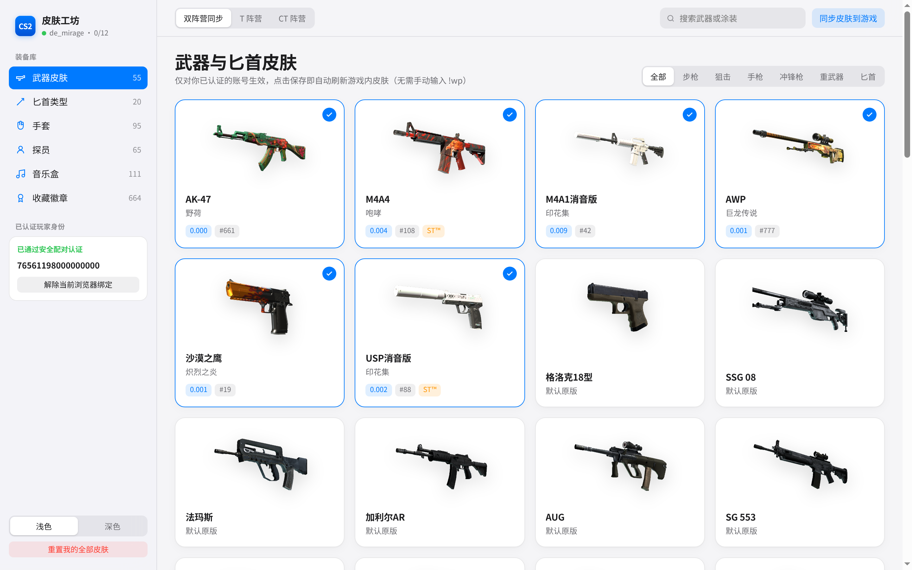
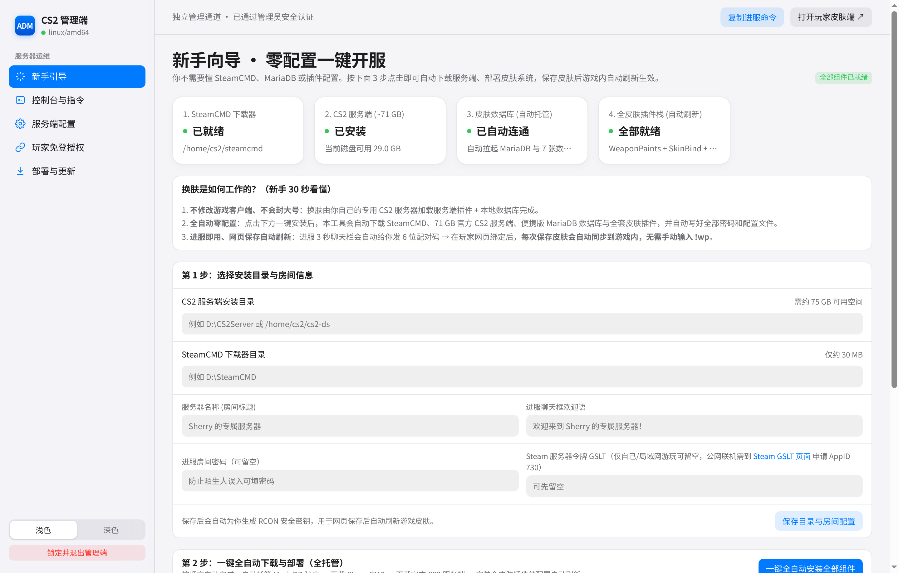
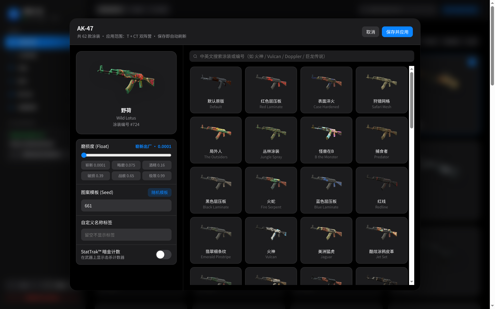
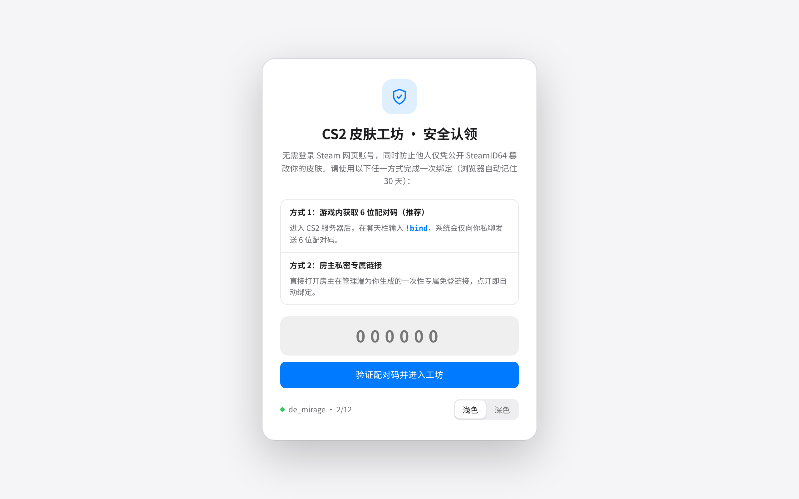
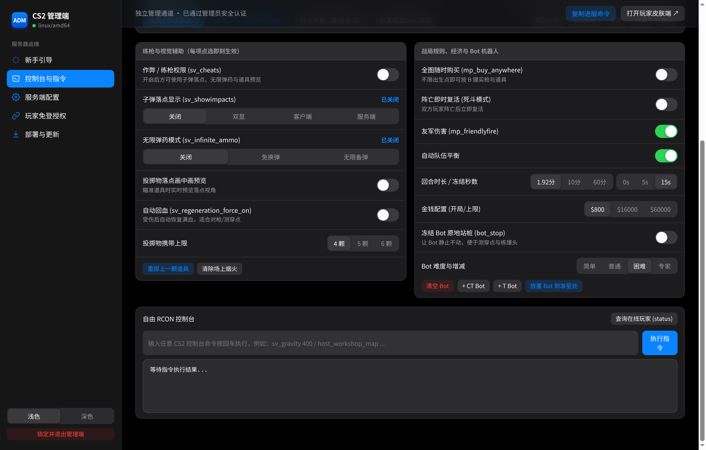
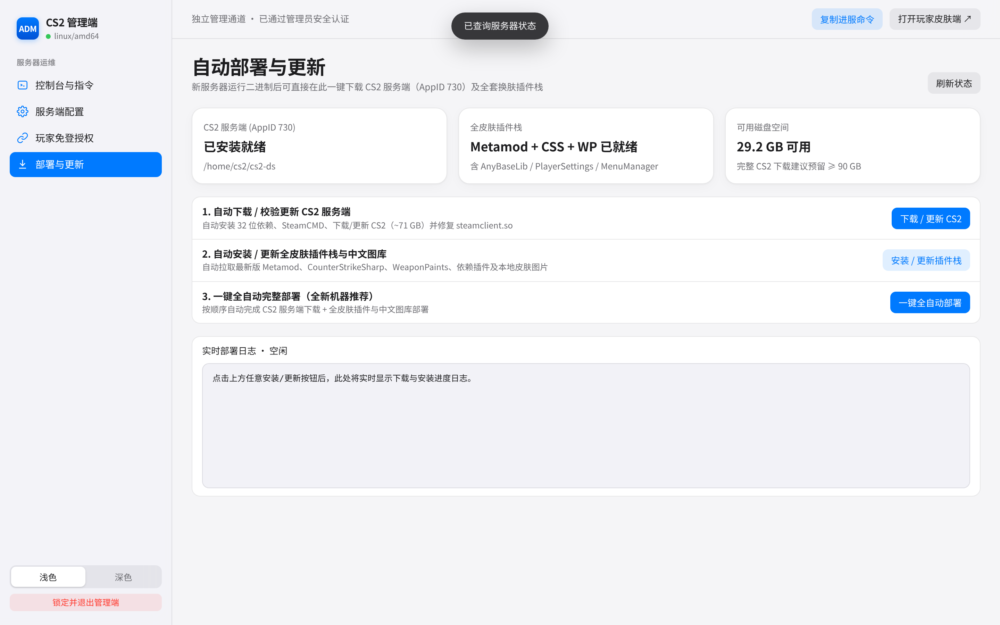
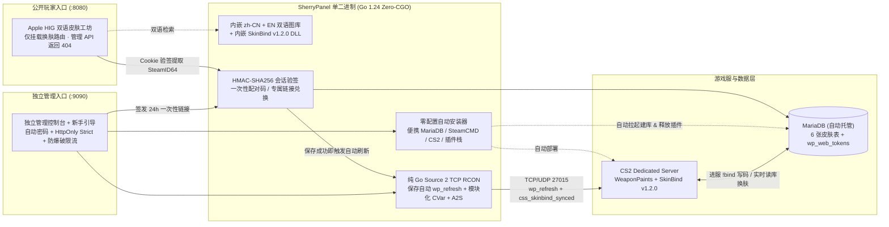

<div align="center">

# SherryPanel

**开箱即用的单文件 CS2 专用服务器管理控制台 & 零配置免 `!wp` 皮肤工坊**

遵循 **Apple 人机界面指南（HIG）** 设计 · **Go 1.24 + Vue 3** 单二进制内嵌双语图库与插件 · **Linux & Windows** 原生跨平台

[](https://github.com/wzwz5200/SherryPanel/releases)
[](https://github.com/wzwz5200/SherryPanel/actions)
[](https://go.dev/)
[](https://vuejs.org/)
[](cs2-plugin-skinbind/)
[](#30-秒极速部署)

[📥 下载最新单文件二进制](https://github.com/wzwz5200/SherryPanel/releases/latest) · [✨ 界面与核心功能](#界面与核心功能全览) · [🔐 安全分离架构](#安全分离与自动刷新架构) · [🚀 30 秒极速部署](#30-秒极速部署) · [📋 版本演进](#版本演进亮点) · [📘 完整文档](docs/DEPLOYMENT.md)

<br/>



*Apple HIG 风格 macOS 分栏界面 · 内嵌 zh-CN + EN 双语全皮肤图库 · 网页保存自动刷新游戏皮肤（无需手动输入 `!wp`）*

</div>

---

## 为什么选择 SherryPanel？

传统的 CS2 换肤与开服方案通常需要手动搭建 Nginx + PHP + MariaDB + SteamCMD + 多个 CS2 插件，不仅对新手极不友好，还长期存在「**必须登录 Steam 网页（国内易被拦截）**」「**公开 SteamID64 任意输入导致被他人乱改皮肤**」「**每次改完皮肤都要回游戏手动敲 `!wp`**」以及「**练枪模式一刀切，连弹着点都不能单独关闭**」等痛点。

**SherryPanel** 将服务端自动部署、数据库自动托管、中英双语换肤工坊与安全管理控制台全部打包进**单一可执行文件**：

| 对比维度 | 传统 PHP 换肤网页 + 手动开服 | **SherryPanel (Go + Vue 3)** |
| :--- | :--- | :--- |
| **新手零配置开服** | 手动装 MariaDB、配库建表、下 SteamCMD、修补 `gameinfo.gi` | **双击运行 + 内置「新手引导」**：一键全自动托管便携版 MariaDB + SteamCMD + CS2 + 全套插件栈 |
| **网页保存生效方式** | 保存后必须切回游戏聊天框手动输入 `!wp` | **保存即自动刷新**：后端通过 Source 2 RCON 自动触发 `wp_refresh` 并聊天通知，**无需再敲 `!wp`** |
| **免登录安全性** | 强制 Steam OAuth（需 API Key）或裸输 SteamID 易被冒充 | **游戏内 `!bind` 自动私发 6 位一次性配对码**（Valve 官方验真）+ 30 天 `HttpOnly` HMAC Cookie |
| **管理与换肤隔离** | 无管理面板，或混装在同一端口存在越权风险 | **物理双端口分离**：`:8080` 纯玩家工坊（管理 API 直接 `404`），`:9090` 独立管理端（强密码 + 防爆破限流） |
| **战局与练枪控制** | 仅支持换皮肤或简陋的固定宏命令 | **模块化独立 CVar 控制台**：子弹落点、无限弹药、画中画道具、经济、死斗、Bot 全部独立实时微调 |
| **图库与跨平台体验** | 依赖外部 JSON 路径，Windows 下 `0.0.0.0` 报错且难找密码 | **二进制内嵌 zh-CN + EN 双语图库**（零路径报错）、Windows 自动持久化密码并输出 `127.0.0.1` 直达地址 |

---

## 界面与核心功能全览

### 1. 新手向导 · 零配置一键开服（v1.3.0）

专为完全不懂 SteamCMD、MariaDB 或 CS2 插件配置的玩家设计。Windows 下双击 `cs2-panel-windows-amd64.exe`（或 Linux 运行 `./cs2-panel`）即可自动生成并持久化管理员密码；首次登录 `:9090` 自动弹出 **「新手引导」**：

* **4 项组件实时自检**：直观显示 SteamCMD、CS2 服务端（~71 GB）、皮肤数据库与全皮肤插件栈的就绪状态；
* **全托管便携版 MariaDB**：Windows 自动下载官方便携版 MariaDB 11.4 ZIP，自动初始化 `cs2_weaponpaints` 数据库与全部 7 张数据表，后续每次启动面板自动拉起托管数据库并热挂载，**无需重启、无需手工建表**；Linux 自动安装并配置 `mariadb-server`；
* **全自动插件部署与配置回写**：一键拉取 Metamod:Source 2.x、CounterStrikeSharp、AnyBaseLib、PlayerSettings、MenuManager、WeaponPaints，并自动释放二进制内置的 **`SkinBind v1.2.0`**、自动生成 RCON 密钥并写入 `WeaponPaints.json` 与 `SkinBind.json`。

<div align="center">

</div>

---

### 2. 全系中英双语皮肤工坊 & 保存即自动刷新（免 `!wp`）

* **二进制内嵌中英双语全量数据**：将 `zh-CN` 与 `EN` 共 10 份官方涂装数据直接内嵌于 Go 二进制中，彻底消除外部 `data/` 缺失告警；卡片与 Sheet 同时呈现中文译名与英文原名，支持中/英文/涂装编号（如 `火神` / `Vulcan` / `Dragon Lore`）混合实时检索；
* **6 大装备全覆盖**：武器皮肤（含 T + CT 双阵营同步或独立配色）、匕首类型、手套、探员、音乐盒与收藏徽章；
* **macOS Sheet 精细定制（浅色 / 深色双外观）**：提供 6 档磨损快捷预设（崭新 `0.0001` → 极限战痕 `0.99`）、精细 Float 滑块、Seed 图案模板与随机生成、自定义名称标签与 StatTrak™ 暗金计数器开关；
* **网页保存自动同步游戏（v1.3.0）**：在网页点击「保存并应用」后，后端立即通过 Source 2 TCP RCON 自动下发 `wp_refresh <steamid64>` 与 `css_skinbind_synced <steamid64>`，**游戏内武器与装备自动刷新生效，无需再手动输入 `!wp`**；右上角亦提供「同步皮肤到游戏」手动一键同步按钮。

<div align="center">

</div>

---

### 3. 零 Steam 登录 · 游戏内 `!bind` 安全配对

无需申请 Steam Web API Key，无需让玩家在网页端输入 Steam 账号密码：

1. 玩家进入 CS2 服务器 **3 秒后**，内置伴生插件 `SkinBind v1.2.0` 通过游戏内聊天框自动私发 **6 位一次性配对码**（随时输入 `!bind` 或 `!skin` 也可重新获取）；
2. 玩家在 `:8080` 输入 6 位配对码（或点击管理员在后台生成的 24 小时专属免登链接）即可绑定当前浏览器 30 天；
3. 后端仅从加密 `HttpOnly` Cookie 验签提取 SteamID64，完全忽略客户端任意提交的账号参数，从根源杜绝冒充篡改他人皮肤。

<div align="center">

</div>

---

### 4. 独立管理控制台 · 精细模块化战局与练枪 CVar 控制（v1.1.0+）

管理端运行在独立端口（默认 `:9090`），内置强密码认证（恒定时间比对）、`SameSite=Strict` Cookie 与防爆破速率限制：

* **模块化独立战局与练枪开关**：不再用「跑图模式」强制捆绑全部参数，所有常用练枪与战局项均可**独立开关、即点即生效**：
  * **练枪与视觉辅助**：`sv_cheats` 总开关、**子弹落点显示（`sv_showimpacts`：关闭 / 双显 / 客户端 / 服务端，随时单独关闭弹着点）**、无限弹药模式（关闭 / 免换弹 / 无限备弹）、投掷物落点画中画预览、自动回血（`sv_regeneration_force_on`）、投掷物携带上限（4/5/6 颗）、重掷上一颗道具与清除场上烟火；
  * **战局规则、经济与 Bot 管理**：全图随时购买、阵亡即时复活（死斗模式）、友军伤害、自动队伍平衡、回合时长 / 冻结秒数、开局金钱（`$800` / `$16000` / `$60000`）、冻结 Bot 原地站桩（`bot_stop`）、Bot 难度切换、增减 Bot 与「放置 Bot 到准星处」；
* **一键场景预设 & 自由 RCON 终端**：保留「跑图全开」「练枪静默（关弹着点）」「死斗热身」「恢复标准 5v5 竞技」等一键预设、官方地图快切与自由 Source 2 RCON 命令行终端。

<div align="center">

</div>

<details>
<summary>点击展开：服务端状态概览、地图快切与部署更新日志页面截图</summary>
<br/>
<div align="center">

<br/><br/>

</div>
</details>

---

## 安全分离与自动刷新架构



---

## 30 秒极速部署

### Windows（Windows 10 / 11 / Server x86_64 · 零配置双击推荐）

无需 WSL、无需手动安装 MariaDB 或配置环境变量：

1. 前往 [GitHub Releases](https://github.com/wzwz5200/SherryPanel/releases/latest) 下载 `cs2-panel-windows-amd64.exe`；
2. **直接双击运行**（或放入新建空目录后运行）。程序将自动：
   * 内嵌加载完整中英双语皮肤图库（无 `data/` 缺失告警）；
   * 自动生成高强度管理员密码并保存到同目录 `panel-config.json`；
   * 在终端清晰打印可直接点击的 **`http://127.0.0.1:8080`**（玩家换肤端）、局域网联机地址与 **`http://127.0.0.1:9090`**（独立管理端）；
3. 浏览器打开 **`http://127.0.0.1:9090`**，输入终端显示的管理员密码登录，按自动弹出的 **「新手引导」** 点击 **「一键全自动安装全部组件」** 即可自动完成便携版 MariaDB + SteamCMD + CS2 服务端 + 全皮肤插件部署。

> **无损演练模式（不想立刻下载 71 GB 服务端？）**：在 PowerShell 中运行以下命令即可体验完整界面与部署流程：
> ```powershell
> $env:DRY_RUN = "true"
> .\cs2-panel-windows-amd64.exe
> ```

### Linux（Debian / Ubuntu x86_64）

```bash
# 1. 下载最新单文件二进制
curl -fsSL https://github.com/wzwz5200/SherryPanel/releases/latest/download/cs2-panel-linux-amd64 -o cs2-panel
chmod +x cs2-panel

# 2. 直接启动（首次自动生成管理员密码并保存到 panel-config.json，打开 :9090 使用「新手引导」一键部署）
sudo ./cs2-panel

# （可选）也可运行交互式命令行向导预先自定义端口与目录：
# sudo ./cs2-panel setup
```

---

## 游戏内快捷指令

| 指令 | 作用 |
| :--- | :--- |
| **网页保存自动刷新（默认）** | 在 `:8080` 保存任意武器、匕首、手套、探员、音乐盒或徽章后，**自动经 RCON 实时刷新游戏内皮肤，无需手动输入 `!wp`** |
| `!wp` | 备用手动刷新指令（如网络波动或切换账号时手动重新拉取数据库皮肤） |
| `!bind` / `!skin` | 游戏内私聊重新获取 6 位一次性配对码（进服 3 秒后也会自动私发一次） |
| `!knife` / `!gloves` / `!agents` / `!music` / `!pins` | 游戏内快捷装备选择菜单 |
| `!st` | 开关 StatTrak™ 暗金击杀计数器 |

---

## 版本演进亮点

| 版本 | 核心更新 |
| :--- | :--- |
| **[v1.3.0](https://github.com/wzwz5200/SherryPanel/releases/tag/v1.3.0)** | 网页保存自动 RCON 刷新（免手动 `!wp`）、内置 `SkinBind v1.2.0`、Apple HIG「新手引导」、Windows 便携版 MariaDB 全自动托管与建库建表、热挂载免重启 |
| **[v1.2.0](https://github.com/wzwz5200/SherryPanel/releases/tag/v1.2.0)** | 二进制内嵌 `zh-CN` + `EN` 全量双语图库与双语检索、自动生成并持久化 `panel-config.json` 管理员密码、修复 Windows `127.0.0.1` / LAN 可点击启动地址 |
| **[v1.1.0](https://github.com/wzwz5200/SherryPanel/releases/tag/v1.1.0)** | 重构模块化战局与练枪 CVar 控制面板（独立开关子弹落点 `sv_showimpacts`、无限弹药、画中画道具、自动回血、经济、死斗与 Bot 精细控制） |
| **[v1.0.0](https://github.com/wzwz5200/SherryPanel/releases/tag/v1.0.0)** | 首个跨平台单文件发布版：双端口物理安全隔离、游戏内 `!bind` 免登配对、纯 Go Source 2 RCON & A2S 查服、自动部署与 GitHub Actions 双平台构建 |

---

## 技术栈与项目结构

* **后端**：Go 1.24（`CGO_ENABLED=0` 零 CGO 静态编译，内嵌前端静态资源、双语图库与 `SkinBind.dll`）
* **前端**：Vue 3 + Vite + 原生 Apple HIG CSS 变量体系（支持浅色 / 深色双主题无缝切换）
* **CS2 伴生插件**：C# / .NET 10 CounterStrikeSharp 插件（`cs2-plugin-skinbind`，已内置编译产物）
* **协议层**：纯 Go 实现 Valve Source 2 TCP RCON 协议与 UDP `A2S_INFO` 查服协议

```text
SherryPanel/
├── main.go                     # 入口：双端口 HTTP 服务、自动密码/配置持久化、托管 DB 启停
├── internal/
│   ├── api/                    # 严格分离的 Player(:8080) 与 Admin(:9090) REST 路由、自动刷新与 CVar 控制
│   ├── auth/                   # HMAC-SHA256 Cookie 会话签发与防爆破 IP 限流
│   ├── catalog/                # 内嵌 zh-CN + EN 双语皮肤库加载与检索索引
│   ├── db/                     # MariaDB 连接池、7 表自动建表 EnsureSchema 与装备 CRUD
│   ├── installer/              # 跨平台自动安装器（便携 MariaDB / SteamCMD / CS2 / 插件栈 / 内置 SkinBind）
│   ├── rcon/                   # 纯 Go Source 2 TCP RCON 与 UDP A2S_INFO 实现
│   └── sysutil/                # Linux systemd 与 Windows 原生 cs2.exe 进程/系统指标管理
├── web/                        # Vue 3 前端源码（皮肤工坊、新手向导、模块化管理控制台）
├── cs2-plugin-skinbind/        # CounterStrikeSharp 伴生插件 SkinBind v1.2.0 源码（.NET 10）
└── docs/                       # 部署运维手册、安全与 API 规范、脱敏界面截图
```

---

## 完整技术文档

* 📘 **[跨平台部署、源码编译与日常运维手册](docs/DEPLOYMENT.md)** — Windows 零配置双击开服、Linux systemd 托管、自定义 `SkinBind.json` 欢迎语、双平台交叉编译与云主机自动关机省钱方案。
* 🔐 **[安全架构、数据库表结构与 REST API 规范](docs/API_AND_SECURITY.md)** — 双端口路由隔离细节、HMAC 会话签发协议、自动刷新 RCON 链路、7 张 MariaDB 表结构与全部 REST API 接口说明。

> **合规提示**：CS2 全皮肤插件（`WeaponPaints`）违反 Valve 公开社区服准则。强烈建议通过管理端设置私服进服密码（`sv_password`）仅限自己与好友私玩，并使用独立小号的 Steam GSLT 令牌，避免影响主账号 GSLT 资格。
