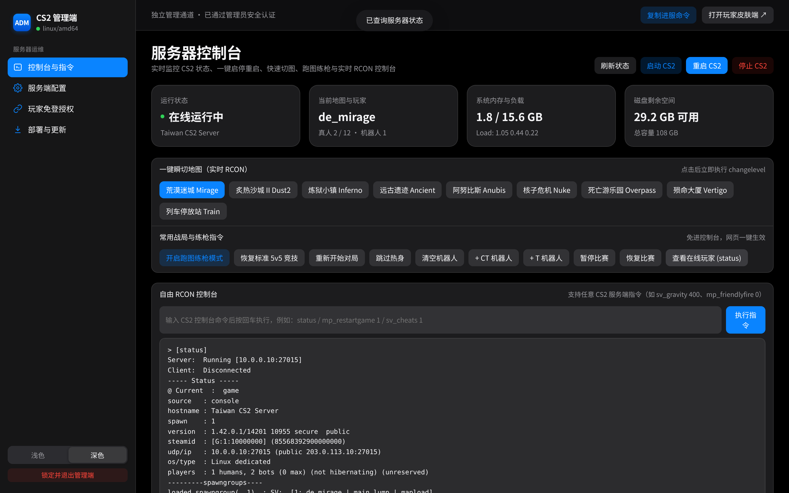
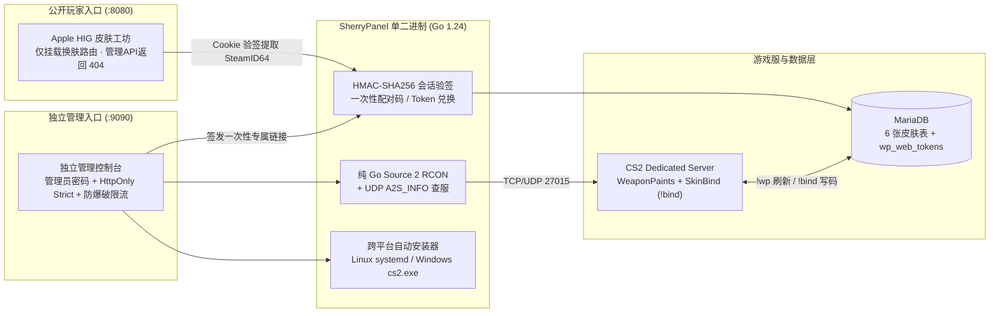

<div align="center">

# SherryPanel

**开箱即用的单文件 CS2 专用服务器管理控制台 & 安全免登录皮肤工坊**

遵循 **Apple 人机界面指南（HIG）** 设计 · **Golang + Vue 3** 单二进制内嵌 · **Linux & Windows** 原生跨平台

[](https://github.com/wzwz5200/SherryPanel/releases)
[](https://github.com/wzwz5200/SherryPanel/actions)
[](https://go.dev/)
[](https://vuejs.org/)
[](#30-秒极速部署)

[📥 下载最新单文件二进制](https://github.com/wzwz5200/SherryPanel/releases/latest) · [✨ 界面与功能预览](#界面与功能全览) · [🔐 安全架构](#安全分离架构) · [🚀 30 秒极速部署](#30-秒极速部署) · [📘 完整文档](docs/DEPLOYMENT.md)

<br/>


*Apple HIG 风格 macOS 分栏与毛玻璃界面 · 本地极速中文皮肤图库 · 无需登录 Steam 网页*

</div>

---

## 为什么选择 SherryPanel？

传统的 CS2 换肤面板往往需要配置 Nginx + PHP + Steam Web API Key，不仅部署繁琐、界面简陋，还经常面临「**必须登录 Steam 网页（国内易被拦）**」或「**公开 SteamID64 任意输入导致被人乱改皮肤**」的安全隐患。**SherryPanel** 从零重构了整个架构：

| 对比维度 | 传统 PHP 换肤网页 | **SherryPanel (Go + Vue 3)** |
| :--- | :--- | :--- |
| **部署与零门槛向导** | Nginx + PHP-FPM + 手动配 MariaDB/SteamCMD/插件 | **单二进制开箱即用**：内置「新手引导」，一键全自动安装便携版 MariaDB + SteamCMD + CS2 + 皮肤插件 |
| **免登录安全性** | 要么强制 Steam OAuth + API Key，要么输别人 SteamID 就能乱改 | **游戏内 `!bind` 自动私发 6 位一次性配对码**（Valve 官方验真）+ 30 天 `HttpOnly` 加密 Cookie，彻底防冒充 |
| **管理与换肤隔离** | 无服务器管理能力，或混装在同一端口存在越权风险 | **物理双端口分离**：`:8080` 纯玩家换肤（管理路由直接 `404`），`:9090` 独立管理端（强密码 + 防爆破限流） |
| **服务器控制力** | 仅能选基础枪皮 | **纯 Go Source 2 RCON**：一键换图、跑图练枪模式、恢复 5v5 竞技、Bot 管理、参数配置与自动部署更新 |
| **全装备与双语内嵌库** | 多为英文或需手动配图库路径 | 二进制内嵌 **zh-CN + EN 双语全套数据**（零外部 `data/` 依赖）+ **网页保存即自动 RCON 刷新（免 `!wp`）** |
| **跨平台支持** | 仅限 Linux | **Linux (`systemd`) & Windows (`kernel32` + `cs2.exe`) 原生双平台**，自带 `DRY_RUN` 安全演练模式 |

---

## 界面与功能全览

### 1. 全系皮肤工坊 · macOS Sheet 精细定制（支持浅色 / 深色双外观）

支持 **T + CT 双阵营同步** 或 **T / CT 独立配色**；点击任意武器或匕首弹出 macOS 表单式 Sheet 定制窗口，提供 **6 档磨损快捷预设（崭新 0.0001 → 极限战痕 0.99）**、精细 Float 滑块、**Seed 图案模板随机**、**自定义名称标签（Nametag）** 与 **iOS 风格 StatTrak™ 暗金开关**。点击保存即通过 Source 2 RCON **自动刷新游戏内皮肤（无需手动输入 `!wp`）**。

| 浅色外观 · 装备总览 | 深色外观 · AK-47 Sheet 定制弹窗 |
| :---: | :---: |
|  |  |

---

### 2. 零 Steam 登录 · 防冒充安全认领 + 进服欢迎语插件

内置 `.NET 10 / CounterStrikeSharp` 伴生插件 **`SkinBind`**，玩家加入 CS2 服务器（已由 Valve 官方校验真实 SteamID）3 秒后自动触发：

```text
★ 玩家 Sherry 加入了服务器，欢迎来到 Sherry 的专属服务器！
========================================
★ 欢迎来到 Sherry 的专属服务器！
网页换肤保存即自动刷新（无需手动输入 !wp） | !bind 重新获取配对码 | !knife 切刀
========================================
[皮肤工坊] 进服自动配对码：482913（10 分钟内有效，仅你可见）
[皮肤工坊] 换肤网页：http://your-server:8080（免 Steam 登录）
```

在网页输入 6 位一次性配对码（或直接点开房主在后台发放的专属链接），浏览器即获得 **30 天 HMAC 签名 `HttpOnly` 会话**；任何只知道你公开 SteamID64 的陌生人都无法查看或修改你的皮肤。

<div align="center">

</div>

---

### 3. 独立管理控制台（`:9090`）· 纯 Go Source 2 RCON 与一键跑图练枪

管理员通过独立端口 `:9090` 凭强密码解锁，无需敲 SSH 或游戏控制台即可完成全部运维：
* **Bento 实时状态卡**：UDP `A2S_INFO` 实时读取在线地图、真人/机器人人数，结合 Linux `/proc` 或 Windows `kernel32.dll` 实时展示内存、负载与磁盘余量；
* **一键瞬切 9 大竞技图**：Mirage、Dust2、Inferno、Ancient、Anubis、Nuke、Overpass、Vertigo、Train；
* **一键跑图练枪 / 恢复 5v5 竞技**：点击「开启跑图练枪模式」自动下发 `sv_cheats 1`、无限弹药、60 分钟回合、全图购买、满额经济与道具轨迹预览；开黑时一键还原标准 5v5 竞技规则；
* **自由 RCON 命令行终端**：输入任意 CS2 控制台命令即时查看原始回显；
* **服务端配置 & 玩家免登授权**：可视化修改服名、进服密码、RCON 密码、Steam GSLT，并可为好友一键签发 24 小时一次性免登换肤链接。

<div align="center">

</div>

---

### 4. 一键自动下载 CS2 服务端与插件栈（Linux & Windows 原生）

新服务器下载单文件后，既可在终端运行交互向导 `./cs2-panel setup`，也可直接在管理端 **「部署与更新」** 页面一键完成 **SteamCMD + CS2 服务端（AppID 730）+ Metamod:Source 2.x + CounterStrikeSharp + AnyBaseLib + PlayerSettings + MenuManager + WeaponPaints + 简体中文皮肤图库** 的全自动拉取、解压与 `gameinfo.gi` / `core.json` 自动修补，并实时滚动输出部署日志。

<div align="center">

</div>

---

## 安全分离架构



---

## 30 秒极速部署

### Linux（Debian / Ubuntu x86_64）
```bash
# 1. 从 GitHub Release 下载最新单文件二进制
curl -fsSL https://github.com/wzwz5200/SherryPanel/releases/latest/download/cs2-panel-linux-amd64 -o cs2-panel
chmod +x cs2-panel

# 2. 运行交互向导（设置端口、管理员密码、目录与数据库，并可选自动下载 CS2 服务端与插件栈）
sudo ./cs2-panel setup

# 3. 启动服务（玩家换肤端 :8080 + 独立管理端 :9090）
sudo ./cs2-panel
```

### Windows（Windows 10 / 11 / Server x86_64）
```powershell
# 1. 下载 Windows 单文件二进制
Invoke-WebRequest -Uri "https://github.com/wzwz5200/SherryPanel/releases/latest/download/cs2-panel-windows-amd64.exe" -OutFile "cs2-panel.exe"

# 2. （可选）先用安全演练模式体验界面与检测流程（不下载 71 GB 服务端）
$env:DRY_RUN = "true"; $env:ADMIN_PASSWORD = "your-password"; .\cs2-panel.exe

# 3. 正式向导配置与启动
.\cs2-panel.exe setup
.\cs2-panel.exe
```

---

## 游戏内快捷指令

| 指令 | 作用 |
| :--- | :--- |
| `!wp` | 立即从数据库刷新你在网页选好的全套武器皮肤、匕首、手套、音乐盒与徽章 |
| `!bind` / `!skin` | 私聊重新获取 6 位一次性配对码（进服 3 秒后也会自动私发一次） |
| `!knife` / `!gloves` / `!agents` / `!music` / `!pins` | 游戏内快捷装备选择 |
| `!st` | 开关 StatTrak™ 暗金击杀计数器 |

---

## 完整技术文档
* 📘 **[跨平台部署、源码编译与日常运维手册](docs/DEPLOYMENT.md)** — MariaDB 初始化、systemd 托管、自定义 `SkinBind.json` 欢迎语、双平台交叉编译与云主机自动关机省钱方案。
* 🔐 **[安全架构、数据库表结构与 REST API 规范](docs/API_AND_SECURITY.md)** — 双端口路由隔离细节、HMAC 会话签发协议、7 张 MariaDB 表结构与全部 REST API 接口说明。

> **合规提示**：CS2 全皮肤插件（`WeaponPaints`）违反 Valve 公开社区服准则。强烈建议通过管理端设置私服进服密码（`sv_password`）仅限自己与好友私玩，并使用独立小号的 Steam GSLT 令牌，避免影响主账号 GSLT 资格。
